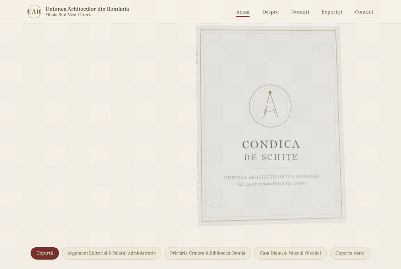
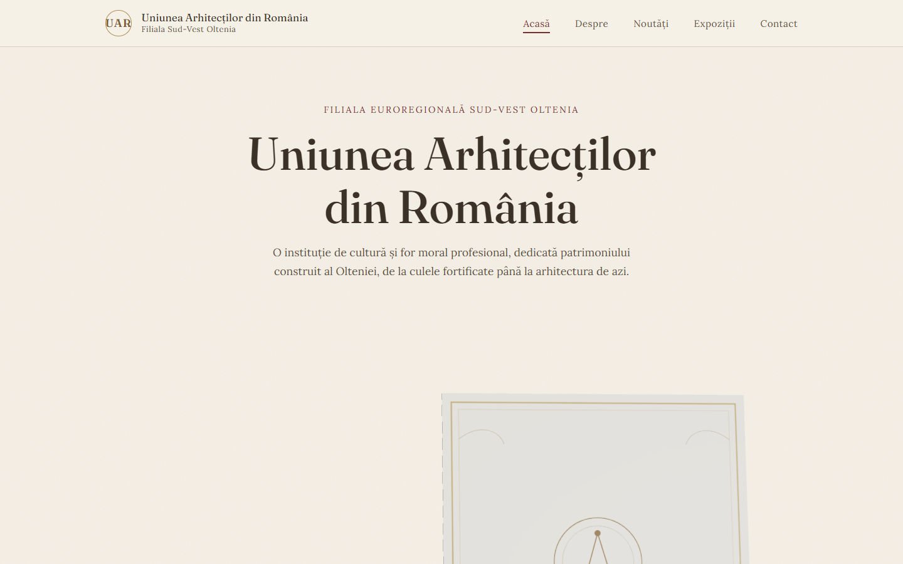

# UAR Oltenia: 3D Heritage Book

**A concept website for the South-West Oltenia branch of the Union of Romanian Architects, built around an interactive 3D book of Craiova's landmark buildings.**

<p align="center">
  
</p>

Instead of a carousel, the homepage opens a *condică* (a bound register) in 3D. Each spread presents a building of Craiova's architectural heritage: the Administrative Palace, the Commerce Bank Palace, the French Library, Casa Dianu, the Oltenia Museum. Pages curl and turn like paper, with real lighting and shadows.

## How the page turn works

Every page is a `SkinnedMesh`: a subdivided plane rigged with a chain of bones along its width. On each frame (`useFrame`), the bones are rotated with [maath](https://github.com/pmndrs/maath) easing toward the target angle, with a second, slower easing factor for the fold. The page bends progressively from the spine instead of rotating as a rigid card. The selected page lives in a Jotai atom, a delayed atom lets each intermediate page turn in sequence, and the navigation is locked while a turn is in progress so fast clicks cannot tangle the animation.

- React Three Fiber + Drei for the scene, ACES filmic tone mapping, soft shadows
- page textures and covers as SVG (`public/textures/book/`), so they stay sharp at any zoom
- the camera pulls back on narrow screens; the 3D viewer is lazy-loaded so the rest of the page renders immediately
- `useReducedMotion` and `useIsMobile` hooks for accessible, lighter behaviour

## The site

| page | content |
|---|---|
| Acasă | hero, 3D book, mission, news ticker |
| Despre | history of the branch since 2007 |
| Noutăți | news |
| Expoziții | exhibitions: Frank Lloyd Wright, S.O.S. Culele (the fortified manor houses of Oltenia) |
| Contact | address, phones, email |

Editorial design system: Fraunces + Lora + Petit Formal Script, warm paper palette as CSS tokens (`src/styles/tokens.css`), ornamental SVG corners, CSS Modules. All content is typed data in `src/content/`, so text can be edited without touching components.

<p align="center"></p>

## Run it

```bash
npm install
npm run dev       # http://localhost:5173
npm run build     # type-check + production bundle
npm run lint      # oxlint
```

Stack: React 19, TypeScript, Vite, three.js, @react-three/fiber, @react-three/drei, @react-three/postprocessing, maath, Jotai, React Router 7, oxlint.

## Note

This is a concept/demo build. Contact details in `src/content/site.ts` are placeholders.

## License

MIT for the code. Names and logos of the Union of Romanian Architects belong to their owner.
